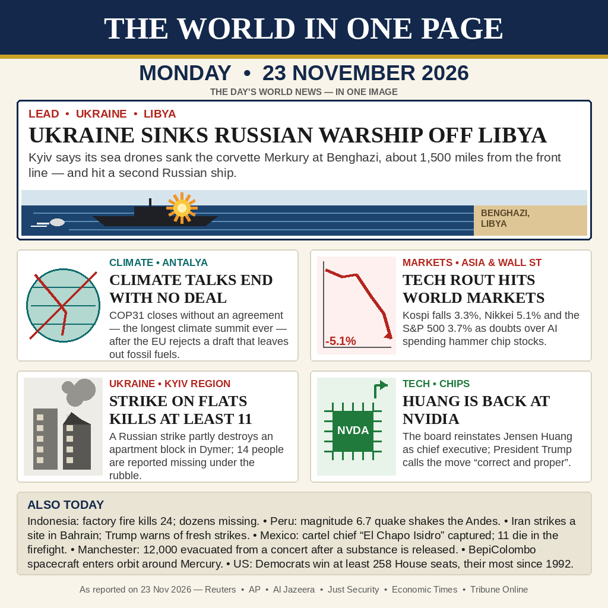

# The World in One Page — 23 November 2026

[](https://make.fun/bounty/news-image-20261123)
[](https://make.fun/bounty/news-image-20261123)
[](https://make.fun/bounty/news-image-20261123)

An entry for the make.fun bounty [Sum up 23 November's world news in one image](https://make.fun/bounty/news-image-20261123).
The program ships one newspaper-style front page that sums up Monday 23 November 2026.



## What the page shows

- **Lead — Ukraine sinks a Russian warship off Libya.** Kyiv says its sea
  drones sank the corvette Merkury at Benghazi, about 1,500 miles from the
  front line, and hit a second Russian ship.
- **Climate — COP31 ends with no deal.** The Antalya summit closes without
  an agreement, the longest climate summit ever, after the EU rejects a
  draft that leaves out fossil fuels.
- **Markets — a tech rout spreads.** The Kospi falls 3.3%, the Nikkei 5.1%
  and the S&P 500 3.7% as doubts over AI spending hit chip stocks.
- **Ukraine — strike on flats kills at least 11.** A Russian strike partly
  destroys an apartment block in Dymer, near Kyiv; 14 people are reported
  missing under the rubble.
- **Tech — Huang is back at Nvidia.** The board reinstates Jensen Huang as
  chief executive; President Trump calls the move "correct and proper".
- **Also today:** a factory fire in Indonesia kills 24; a magnitude 6.7
  quake shakes Peru's Andes; Iran strikes a site in Bahrain; Mexico captures
  cartel chief "El Chapo Isidro"; 12,000 are evacuated from a Manchester
  concert; BepiColombo enters orbit around Mercury; US Democrats win at
  least 258 House seats.

Every story is labelled in the image itself, with the date
**Monday 23 November 2026** across the top, so the page reads on its own.
The facts are as reported on 23 November 2026 by Reuters, AP, Al Jazeera,
Just Security, the Economic Times and Tribune Online; nothing is invented.

## How the image was drawn

`draw_image.py` draws the whole page with Pillow and the Liberation
fonts: a navy masthead, a gold date banner, a lead panel with a drawn sea
scene (warship, explosion burst, sea drone, the Benghazi coast), four
panels each with its own small drawn scene (a cracked globe, a falling
chart, damaged flats, a chip), and an "also today" strip. Fixed text,
colours and geometry — no network, no clock, no randomness — so the same
script always draws the same pixels.

## How it runs

```sh
python3 main.py
```

`main.py` checks the bundled `entry.png` (PNG magic bytes, IHDR checksum,
whole IEND chunk, at most 1 MiB and 1024 by 1024) and copies it to
`/output/entry.png` (or `$MAKEFUN_OUTPUT_DIR` when the harness sets one),
printing its size. Run it twice and both runs write identical bytes.

## Files

- `main.py` — the entry program: validates and copies the image.
- `entry.png` — the finished front page, 1024 by 1024.
- `draw_image.py` — the script that drew `entry.png`.
- `README.md` — this file.
- `LICENSE` — MIT.
